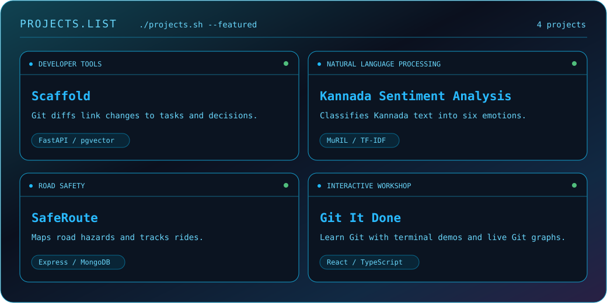

  

<b>Mohammed Mohsin Mahaboob Basha</b> · Computer Science Student DeepStation MSRIT — Core Team Member (2025 – Present)
MUKTI Open Source &amp; Cybersecurity Club – MSRIT — Core Team Member (2026 – Present)

<a href="https://github.com/themdmohsin">GitHub</a>

<b>📌 Top projects</b>

 

<a href="https://github.com/themdmohsin/Scaffold">Scaffold</a> · <a href="https://github.com/themdmohsin/kannada_sentiment_analyser">Kannada Sentiment Analysis</a> · <a href="https://github.com/themdmohsin/SafeRoute">SafeRoute</a> · <a href="https://github.com/themdmohsin/Incident-Response-Training-Game">Incident Response Training Game</a>

<b>🧰 Stack</b>

 

  

<b>📊 By the numbers</b>

 

  

<b>🟩 Activity</b>

 

  

<b>👋 Say hello</b>

 

<a href="https://github.com/themdmohsin">GitHub</a> · <a href="mailto:mohammed160106@gmail.com">Email</a>

## Experience

**DeepStation MSRIT — Core Team Member** · 2025 – Present

- Help organize workshops and events, including the Google × DeepStation × MSRIT Hackathon.

**MUKTI Open Source &amp; Cybersecurity Club – MSRIT — Core Team Member** · 2026 – Present

- Help organize workshops and events on Linux, Git/GitHub, open source, and cybersecurity.
- Speak at and organize a workshop on Git, GitHub and Open Source Contribution.

**Education**

- B.E. in Computer Science &amp; Engineering with specialization in AI &amp; ML — Ramaiah Institute of Technology (MSRIT), Bangalore (2024 – 2028)

**Projects**

- **SafeRoute — AI-Powered Road Safety Platform** — Built a full-stack road safety platform featuring hazard reporting, ride tracking, user authentication, and analytics dashboards. Developed REST APIs for users, hazard reports, and ride sessions using Express.js, MongoDB
- **ClimateShield — Urban Climate Risk &amp; Emergency Response Platform** — Built a platform where citizens report hazards, government operators manage incidents, and rescue teams are dispatched. Implemented SOS reporting, incident management, and rescue dispatch workflows with role-based access
- **Scaffold — AI-Powered Project Intelligence Platform** — Connects GitHub events and Git diffs to tasks, decisions, and dependencies. Uses FastAPI, PostgreSQL, pgvector, and MCP to share project context with developers and AI agents.
- **Kannada Sentiment Analysis — Hybrid ML Model** — Combined MuRIL BERT and TF-IDF to classify text across six emotion classes with 93% accuracy. Deployed an interactive classifier on Streamlit Cloud.
- **Kabadiwala Connect — E-Waste Traceability Platform** — Built an offline-first workflow for collectors to identify materials, estimate prices, and find buyers. Lot and handover records track weight, location, and transaction history across collectors, dealers, and recyclers.
